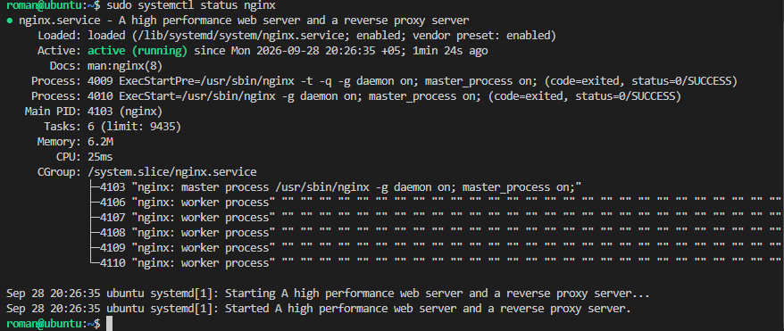
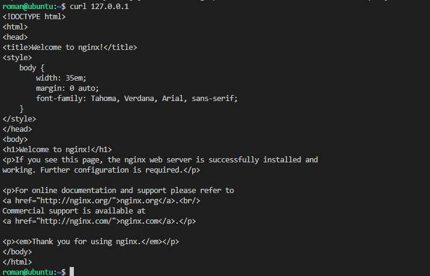
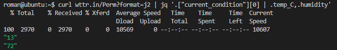
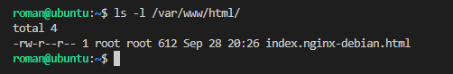
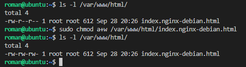
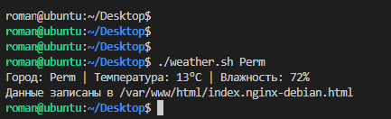
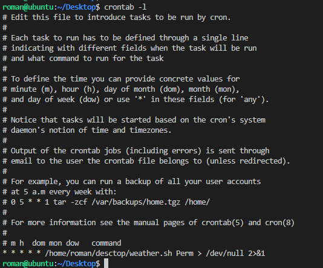
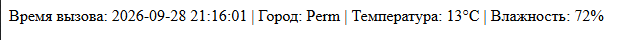

## Описание задания

**П02. Автоматизация в Linux**

**Цель:** написать bash-скрипт для автоматического получения данных о погоде и отображения их на веб-странице.

**Задачи:**

1. Написать bash-скрипт, который принимает в качестве входящего параметра город.
2. Скрипт должен выводить температуру и влажность в текущий день в этом городе.
3. Установить nginx.
4. Настроить запуск скрипта по крону — раз в минуту.
5. Вывод скрипта сохранять в `index.html` дефолтного сайта.

**Требования к реализации:**

- Использовать сервис [wttr.in](https://github.com/chubin/wttr.in) в формате JSON.
- Использовать библиотеку `jq` для работы с JSON.

**Примечание:** если `wttr.in` не работает, допускается использовать любой другой ресурс, отдающий результат в формате JSON. Пример:

```bash
curl https://jsonip.com
{"ip":"212.192.71.106"}
```

## Выполнение задания

### 1. Установка и проверка Nginx
Установил веб-сервер Nginx и убедился, что он корректно запущен и отвечает на запросы.



### 2. Проверка работы веб-сервера через `curl`
Отправил тестовый запрос к локальному веб-серверу с помощью утилиты `curl`, чтобы убедиться в его доступности.



### 3. Получение данных о погоде
Проверил работу внешнего API `wttr.in`: выполнил запрос и получил текущую температуру и влажность для заданного города.



### 4. Проверка прав доступа к файлам веб-сервера
Проверил права пользователя на файлы в директории `/var/www/html/`.



### 5. Изменение прав для записи
Изменил права на файл `index.nginx-debian.html`, чтобы скрипт мог записывать в него данные о погоде.



### 6. Проверка скрипта
Протестировал работу скрипта `weather.sh` — он успешно получает данные и записывает их в файл веб-сервера.



### 7. Решение проблемы с кодировкой
При отображении страницы в браузере столкнулся с проблемой кодировки — русские буквы отображались некорректно.

**Решение:** указал кодировку `utf-8` в конфигурации Nginx.

```bash
sudo nano /etc/nginx/sites-available/default
```

```nginx
server {
    listen 80 default_server;
    listen [::]:80 default_server;

    root /var/www/html;
    index index.html index.htm index.nginx-debian.html;

    server_name _;

    charset utf-8;   # <-- добавил эту строку

    location / {
        try_files $uri $uri/ =404;
    }
}
```

Проверил конфигурацию и перезапустил Nginx:


### 8. Проверка результата
После перезапуска Nginx страница в браузере отображается корректно — русский текст читается правильно.


### 9. Настройка задания в Cron
Добавил задание в `crontab` для автоматического обновления данных о погоде каждую минуту.

На этапе настройки допустил ошибку в пути к скрипту, из-за чего задание не выполнялось. Ошибку исправил.



### 10. Доработка скрипта
Дополнительно изменил скрипт `weather.sh`: добавил временную метку вызова, чтобы было удобно отслеживать, когда данные были обновлены в последний раз.

**Результат работы:**




